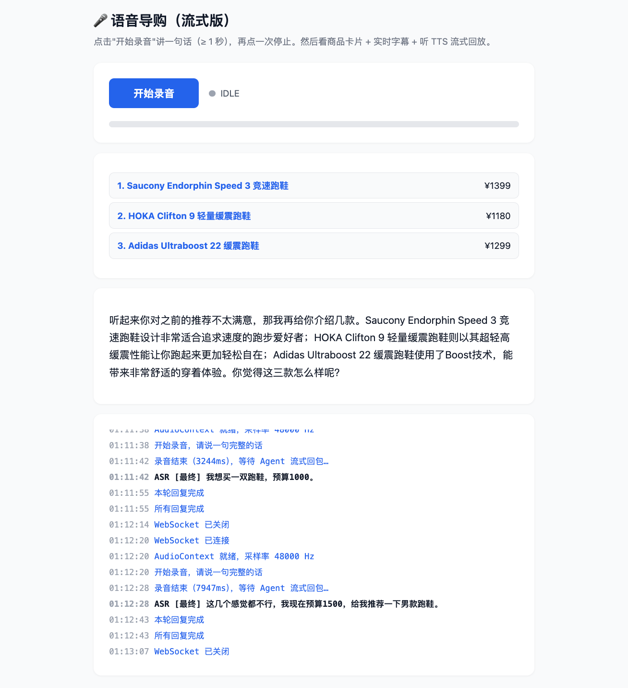
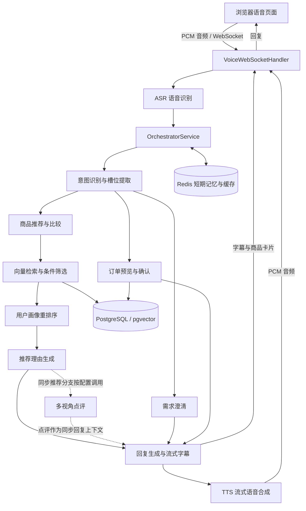

# Voice Shopping 语音购物助手

基于 AgentScope Java 的多智能体语音导购项目：通过语音表达需求，在多轮对话中调整预算、筛选商品，并完成演示订单的预览与确认。

项目提供可在浏览器中使用的语音演示页面，串联 **ASR 语音识别 → 多 Agent 对话处理 → 商品检索与推荐 → 流式字幕与 TTS 语音回复**。

## 运行截图



截图展示用户将跑鞋预算改为 **1500 元**后的重新推荐，包括三款商品的名称与价格、助手回复，以及底部的语音识别日志。该页面为开发演示界面。


## 交互示例

以下为演示台词与预期交互流程，具体商品以数据库内容和实际推荐结果为准。

| 轮次 | 用户输入 | 系统处理 |
| --- | --- | --- |
| 1 | 我想买一双在水泥路上慢跑的跑鞋。 | 识别品类与用途，缺少必要信息时追问 |
| 2 | 预算一千元以内。 | 补充预算，检索并展示推荐商品 |
| 3 | 预算改成八百元以内，重新推荐。 | 更新预算，按新的条件重新推荐 |
| 4 | 就选第一款。 | 引用上一轮展示的第一款商品，生成订单预览 |
| 5 | 确认。 | 写入演示订单、扣减库存并返回确认结果 |

订单流程用于演示业务闭环，尚未接入真实支付或物流履约。

订单预览在 Redis 中保留 10 分钟，不预占库存。确认时通过 PostgreSQL 商品行锁串行检查和扣减库存，
订单与库存变更在同一事务中提交；同一预览使用固定订单号和现有 `order_no` 唯一约束，
并发确认或残留预览的重试会复用已成交订单，不重复扣库存。预览已清理或过期时需要重新选择。
提交成功后才清理对应预览、发布购买事件和触发记忆回流，清理操作不会删除同会话的新预览。
这些提交后操作失败会记录日志，不撤销已成交订单；画像通知当前没有持久化补偿队列。

本次修复不需要修改表结构。升级时应停止旧版本的确认请求；升级前缓存的预览缺少固定订单号，
不能直接确认，需要重新选择商品，也可以等待其 10 分钟 TTL 到期。

## 已实现功能

| 功能 | 说明 |
| --- | --- |
| 语音交互 | 浏览器录音，经 WebSocket 发送音频，接收 ASR 结果、商品卡片、字幕和 TTS 音频 |
| 意图识别与槽位提取 | 识别推荐、比较、确认订单等意图，提取品类、预算、用途等条件 |
| 多轮澄清 | 提供澄清分支与需求条件合并；页面是否进入追问取决于意图识别与业务路由 |
| 需求更新 | 支持修改预算、预算区间和品类，处理新需求与历史条件之间的关系 |
| 商品推荐 | 结合语义检索、条件筛选和用户画像重排序，返回候选商品 |
| 上下文比较 | 基于上一轮推荐处理商品比较及“便宜一点”“贵一点”等调整 |
| 商品引用 | 支持“第一款”等序号引用，保留上一轮展示顺序 |
| 演示订单 | 支持订单预览、确认、取消待确认订单及当前会话订单状态查询 |
| 目录查询 | 根据当前商品目录回答可选品类 |
| 情绪化回复与闲聊 | 根据用户表达调整回复方式，并处理简单闲聊 |
| 多视角点评 | 已实现价格顾问、专业跑者、入门买家协作，接入同步推荐分支；页面的流式推荐分支尚未调用 |
| 会话与用户记忆 | 保存近期对话、需求条件、推荐列表，并提供用户偏好回流机制 |


## 技术栈

| 模块 | 技术 |
| --- | --- |
| 后端 | Java 21、Spring Boot 4.0.5 |
| Agent 构建与协作 | AgentScope Java 1.0.11、Spring AI Alibaba AgentScope Starter |
| 大语言模型 | DashScope：主模型 `qwen-max`、轻量模型 `qwen-turbo`；多视角团队使用 `qwen-plus` |
| 语音识别 | DashScope：`paraformer-realtime-v2` |
| 语音合成 | DashScope：`cosyvoice-v1`，默认音色 `longwan` |
| 文本向量 | DashScope：`text-embedding-v3`，数据库向量列为 1024 维 |
| 数据存储 | PostgreSQL、pgvector、pg_trgm、Spring Data JPA |
| 缓存与短期记忆 | Redis |
| 流式传输与处理 | WebSocket、Reactor、RxJava |
| 监控 | Spring Boot Actuator、Micrometer、Prometheus |

## 核心架构



`OrchestratorService` 根据识别出的意图选择业务分支，再结合会话状态、商品检索、订单服务和回复生成完成处理。Agent 负责理解与生成，筛选条件、商品引用和订单状态由业务代码管理。

语音页面调用 `streamHandle()`：推荐意图直接检索商品并生成流式回复，其他意图转入 `handle()` 的同步业务分支，再返回文本与 TTS。同步推荐分支包含必填条件检查与多视角点评；流式推荐分支目前未接入这两步。因此，页面不会对每次推荐都执行完整的必填条件追问，也不会自动调用点评团队。

### 多智能体分工

| Agent / 团队 | 职责 |
| --- | --- |
| IntentAgent | 识别当前意图并提取需求槽位 |
| ClarifyAgent | 根据 `ClarifyRuleService` 找出的缺失字段生成追问 |
| RecommendAgent | 为候选商品生成推荐理由 |
| EmotionAgent | 根据用户情绪和业务结果调整回复 |
| PerspectiveTeam | 在同步推荐分支启用时，通过价格顾问、专业跑者、入门买家三个视角点评候选商品 |

### 记忆与会话状态

- **短期记忆**：主链路将每轮对话摘要以 `TURN` 记录写入 Redis，默认保留最近 10 条摘要，写入时刷新 30 分钟 TTL；意图识别读取最近 3 条摘要。
- **业务状态**：`SessionStateService` 管理当前意图、已填槽位、待追问信息及上一轮推荐列表，用于连续对话与商品引用。
- **用户画像**：数据库与 DTO 保存静态属性、品类/品牌偏好及近期浏览/购买等字段。当前重排序主要结合预算、平均订单金额、价格敏感度和近期购买记录；品牌加分还依赖候选商品的 `attributes.brand`，演示数据的品牌主要保存在独立 `brand` 列中，因此不能认为所有画像字段均已生效。
- **长期记忆回流**：订单确认、语音连接关闭等时机会调用异步回流，当前主要累加品类偏好。价格敏感度统计仍筛选 `USER` 记录，与主链路的 `TURN` 摘要格式不一致，不能描述为已完成价格偏好自动学习。
- **Agent 记忆控制**：意图 Agent 在调用前清空自身记忆，推荐理由 Agent 在调用前裁剪至最近 8 条消息；情感 Agent 的按轮裁剪方法未被回复服务调用，但 `AgentMemoryGuard` 每分钟检查一次，超过 40 条消息时清空其全部内部记忆。这与始终保留最近 20 轮的策略不同。

### 推荐引擎

推荐主链路由 `ParallelRecommendService` 组织：并行加载用户画像和检索候选商品，再进行排序与推荐理由生成。

1. 将用户输入转换为查询向量，在 pgvector 中进行商品语义检索。
2. 将预算、品类、商品属性和商家范围等条件合并到筛选逻辑中。
3. 读取候选商品详情，并再次应用商家范围约束。
4. 通过 `ProfileReranker` 结合用户画像与当前需求调整排序。
5. 取至多三款商品，生成推荐理由。同步推荐分支按配置加入多视角点评；页面的流式推荐分支直接进入流式回复生成。

商家范围通过会话接口建立；当前语音演示页面不调用该接口，缺少范围配置时按全平台检索。

### 流式语音处理

- 浏览器将录音转换为 16 kHz、16-bit、单声道 PCM，通过 WebSocket 分块上传。
- ASR 返回识别文本，最终识别结果进入业务处理；预算表述被拆成多段时，入口提供拼接处理。
- 同一连接中的回复按轮次排队，上一轮处理及 TTS 完成后开始下一轮。
- 推荐回复按句子聚合后发送字幕并合成音频；澄清、比较、订单等同步业务分支先生成完整文本，再发送字幕与 TTS。
- 后端分别发送商品数据、字幕和音频，页面显示商品卡片并播放 TTS。
- `turn_start`、`turn_done` 和 `done` 区分单轮回复与整次输入的完成状态。

### 语音连接鉴权

- 页面将已有登录 Token 通过 `Sec-WebSocket-Protocol` 请求头发送，URL 仅携带客户端生成的会话 UUID。
- 客户端同时提供 `voice.v1` 与 `Bearer-<token>`；后端校验 Sa-Token 登录态后，只协商 `voice.v1`，不将 Token 回写到响应头。
- 用户 ID 来自校验后的 Token，客户端传入的 `userId` 不作为身份依据；服务端将用户 ID 与会话 UUID 组合，隔离不同用户的语音会话。
- 缺失或失效的 Token 会拒绝握手；异常凭据与会话参数也会被拒绝。会话服务进一步检查已有会话的所属用户。
- 默认按同源策略接入页面。通过 HTTPS 代理转发到 HTTP 后端时，使用 `VOICE_SHOPPING_ALLOWED_ORIGINS` 显式配置外部页面的 Origin，例如 `https://shop.example`；多个来源以逗号分隔，不支持通配符或路径。远程访问使用 HTTPS/WSS，Token 校验发生在每次建立连接时。

### HTTP 文本聊天鉴权

`POST /api/v1/chat` 使用同一套 Sa-Token 登录态，请求头需携带 `Authorization: Bearer <token>`。
用户身份从登录态读取，不再需要 `userId` 参数；旧请求即使传入该参数，也不会改变实际身份。
缺失或失效的令牌返回 `401`，使用其他用户已有的会话返回 `403`。

```bash
curl -X POST 'http://localhost:8080/api/v1/chat?sessionId=your-session-id' \
  -H 'Authorization: Bearer your-login-token' \
  -H 'Content-Type: text/plain; charset=UTF-8' \
  --data-raw '我想买一双跑鞋'
```

## 快速开始

以下步骤面向本地开发演示，需要自行准备 PostgreSQL、Redis 和可用的 DashScope API Key。

### 1. 环境要求

- JDK 21
- Maven 3.8+
- PostgreSQL 15+，安装 pgvector，并可启用 `vector` 与 `pg_trgm` 扩展
- Redis 6+
- DashScope API Key，以及对应模型的调用权限
- 支持麦克风和 Web Audio 的浏览器

### 2. 获取项目

```bash
git clone https://github.com/ZhaoYJ9/voice-shopping.git
cd voice-shopping
```

### 3. 初始化开发数据库

以下命令通过本机 PostgreSQL 默认连接创建一个独立的开发数据库；如使用远程数据库，请补充相应主机、端口和用户参数。

```bash
createdb zyj_voice_shopping
psql -v ON_ERROR_STOP=1 -d zyj_voice_shopping -f src/main/resources/sql/schema.sql
```

应用配置使用 `ddl-auto: validate`，启动时校验表结构，不会自动创建业务表。建表脚本还会创建向量索引，需要使用支持 HNSW 的 pgvector 版本。

首次体验时，可向这个独立的开发数据库导入演示数据：

```bash
psql -v ON_ERROR_STOP=1 -d zyj_voice_shopping -f src/main/resources/sql/data.sql
```

**`data.sql` 含有 `TRUNCATE TABLE ... CASCADE`，会清空相关表，只应在专用演示数据库中执行。** 登录用户需要在数据库中存在，脚本已提供 `alice`、`bob` 等演示用户。

### 4. 配置环境变量

在启动应用的终端中设置以下变量，将示例值替换为自己的连接信息：

```bash
export VOICE_SHOPPING_DB_URL='jdbc:postgresql://localhost:5432/zyj_voice_shopping'
export VOICE_SHOPPING_DB_USERNAME='your-db-user'
export VOICE_SHOPPING_DB_PASSWORD='your-db-password'
export VOICE_SHOPPING_REDIS_HOST='localhost'
export VOICE_SHOPPING_REDIS_PORT='6379'
export VOICE_SHOPPING_REDIS_PASSWORD=''
export DASHSCOPE_API_KEY='your-dashscope-api-key'
```

Redis 默认使用数据库 3；如果 Redis 配置了密码，请填写相应值。不要将真实密钥或密码写入提交的文件。

模型、会话和语音参数位于 [`application.yml`](src/main/resources/application.yml)。

### 5. 编译并启动

```bash
mvn clean package -DskipTests
java -jar target/zyj-voice-shopping-1.0-SNAPSHOT.jar
```

上述命令用于打包运行，跳过测试；测试命令见下文。

应用启动时还会调用 TTS 服务预热短语缓存，需要可用的 DashScope API Key 与网络连接。

本地开发也可运行 `mvn spring-boot:run`。代理、模型配置和 Maven 仓库错误的排查步骤见 [本地启动与常见错误](docs/local-startup.md)。

### 6. 生成商品向量

导入演示数据后，调用向量重建接口为商品生成 Embedding：

```bash
curl -X POST http://localhost:8080/api/v1/admin/reindex
```

检查返回的 `indexed` 与 `failed` 数量，确认商品成功建立向量。此步骤会调用 DashScope Embedding 服务。需要体验独立 FAQ 接口时，可再调用 `POST /api/v1/admin/faq-reindex`。

### 7. 打开语音页面

访问 [http://localhost:8080/voice-test.html](http://localhost:8080/voice-test.html)，允许麦克风权限。

先在页面的“访问令牌”输入框填入登录后获得的 Token。令牌仅保留在当前页面内存中，不写入 URL 或浏览器持久化存储。

在可信的本地演示环境，可通过现有演示登录接口取得 Token：

```bash
curl -X POST http://localhost:8080/api/v1/auth/login \
  -H 'Content-Type: application/json' \
  -d '{"username":"alice"}'
```

将响应中的 `token` 值填入页面。**这个登录接口目前仅按用户名发放 Token，不校验密码，不能作为生产身份认证。** 本次语音鉴权只校验已有 Token，正式账号密码登录需另行完善。

点击“开始录音”，说一句完整需求，再点击停止，等待商品卡片、字幕和语音回复。本地通过 `localhost` 访问；远程演示需要配置 HTTPS/WSS，反向代理需支持 WebSocket。

如果使用 HTTPS 反向代理，在后端启动环境中增加 `VOICE_SHOPPING_ALLOWED_ORIGINS=https://你的前端域名`（填写实际域名，不带路径），并确保代理转发 `Sec-WebSocket-Protocol` 请求头。握手响应只返回 `voice.v1`；不要在代理访问日志中记录携带 Token 的协议请求头。

## 意图缓存

同一会话内，“我想买手机”“想买手机”“嗯，我想要买手机”等已知等价表达可命中相同的意图缓存，有效期为 5 分钟。归一化保留否定、商品、数量和小数预算等差异。

这是一组确定性规则，不是通用语义相似度检索；缓存键也尚未包含历史对话版本。支持范围、旧缓存隔离策略及测试方式见 [意图缓存与口头表达归一化](docs/intent-cache.md)。

## 测试

后端测试：

```bash
mvn test
```

在部分 Java 21 环境中，Mockito 动态加载 Agent 可能受限。若出现相关错误，可显式指定项目依赖的 Mockito Agent：

```bash
mvn test -DargLine="-javaagent:$HOME/.m2/repository/org/mockito/mockito-core/5.20.0/mockito-core-5.20.0.jar"
```

页面逻辑测试需要额外安装 Node.js：

```bash
node --test src/test/js/*.test.cjs
```

| 测试入口 | 主要覆盖内容 |
| --- | --- |
| `RecommendationRoutingTest`、`OrchestratorConversationTest` | 需求更新与多轮推荐路由 |
| `BudgetUtteranceTest`、`SqlFilterBuilderTest` | 预算表达解析与筛选条件 |
| `OrderReferenceResolverTest`、`OrchestratorOrderStateTest` | 商品引用、订单确认和状态处理 |
| `VoiceWebSocketHandlerTest` | 语音入口、回复排队与状态通知 |
| `AuthHandshakeInterceptorTest`、`VoiceProtocolNegotiationTest`、`SessionServiceTest` | Token 握手校验、协议协商与会话所属用户检查 |
| `TtsServiceTest`、`EmotionStreamingServiceTest` | 流式回复、合成完成与取消处理 |
| `voice-test-response.test.cjs`、`voice-test-stop.test.cjs` | 页面回复状态、字幕保留与停止录音处理 |
| `voice-test-auth.test.cjs` | 页面令牌传输、会话重连及连接失败处理 |

这些测试用于验证代码逻辑。真实麦克风、DashScope 调用、网络传输和音频播放仍需单独进行端到端验证。

订单并发集成测试使用真实 PostgreSQL 和 Redis，默认不启用。准备好专用测试实例后运行：

```bash
mvn -Dtest=OrderConcurrencyIntegrationTest \
  -Dorder.test.jdbc-url=jdbc:postgresql://127.0.0.1:55439/postgres \
  -Dorder.test.db-user=order_test \
  -Dorder.test.redis-port=56389 test
```

数据库账号需有创建 schema 权限；需要密码时可传 `-Dorder.test.db-password`。测试创建并清理随机独立 schema，
Redis 仅使用随机测试会话键，不清空数据库。测试覆盖最后一件抢购、同预览并发确认、事务回滚、
新预览替换、清理失败重试、通知失败、旧预览兼容和非法数量，不调用模型服务。
完整后端回归时保留上述连接参数并去掉 `-Dtest`。本机代理导致连接失败时，参考[本地启动说明](docs/local-startup.md)。

## 当前限制

- 项目面向学习与功能演示，尚未完成生产环境和多用户容量验证。
- 订单确认会扣减库存并写入状态为 `PAID` 的演示订单，但没有调用支付服务，也没有真实配送能力。
- 语音握手已接入已有 Token 的校验，但登录接口仍是用户名演示入口；公开部署前需要完善真正的身份认证。当前 Token 在建立连接时校验，尚未接入长连接期间的实时失效检测。
- 页面流式推荐尚未接入同步推荐分支的必填条件检查和多视角点评，长期记忆与情感记忆裁剪也存在上述接入限制。
- `ComplianceChecker` 已接入同步业务回复与流式空结果回复；成功的流式推荐文本目前直接进入字幕与 TTS，尚未经过该检查，不能宣称所有语音输出都已接受统一内容过滤。
- 当前页面包含开发日志，部署时应根据场景整理调试界面和调试接口。
- 语音识别、模型回复和检索结果受输入、数据及外部服务影响；本文不承诺固定延迟、准确率或并发量。

## 项目结构

```text
src/
├── main/
│   ├── java/com/zhaoyijin/voiceshopping/
│   │   ├── agent/          # Agent 构建、提示词加载与记忆策略
│   │   ├── compliance/     # 回复内容检查
│   │   ├── config/         # 模型、Redis、数据库与 WebSocket 配置
│   │   ├── controller/     # HTTP 接口与语音 WebSocket 入口
│   │   ├── dto/            # 意图、推荐、会话与画像 DTO
│   │   ├── entity/         # 数据实体与流式消息
│   │   ├── event/          # 事件发布与监听
│   │   ├── listener/       # 会话过期等监听器
│   │   ├── memory/         # 短期记忆与对话摘要
│   │   ├── repository/     # 数据访问
│   │   ├── security/       # 用户身份相关组件
│   │   ├── service/        # 对话编排、检索、画像与订单业务
│   │   └── voice/          # ASR、TTS 与文本聚合
│   └── resources/
│       ├── application.yml
│       ├── clarify/        # 澄清规则
│       ├── compliance/     # 内容检查词表
│       ├── prompts/        # Agent 提示词
│       ├── sql/            # 建表与演示数据脚本
│       └── static/         # voice-test.html 语音演示页面
└── test/
    ├── java/               # 后端测试
    └── js/                 # 页面逻辑测试
docs/images/                # README 运行截图
```

主要 DTO 包括 `IntentResult`、`RecommendResult`、`EmotionResult`、`SessionScope` 和 `UserProfileSnapshot`，分别承载意图识别、推荐结果、回复内容、会话范围和用户画像。

## 使用说明

本项目仅供学习和研究使用。模型服务的权限、调用额度与费用以实际服务商配置为准。
